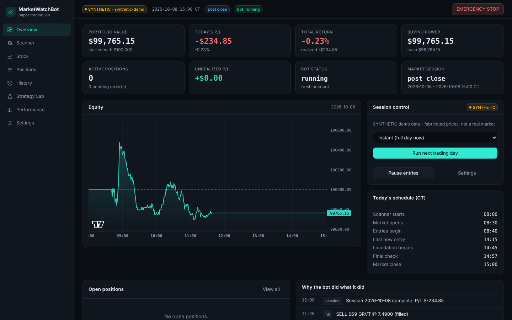
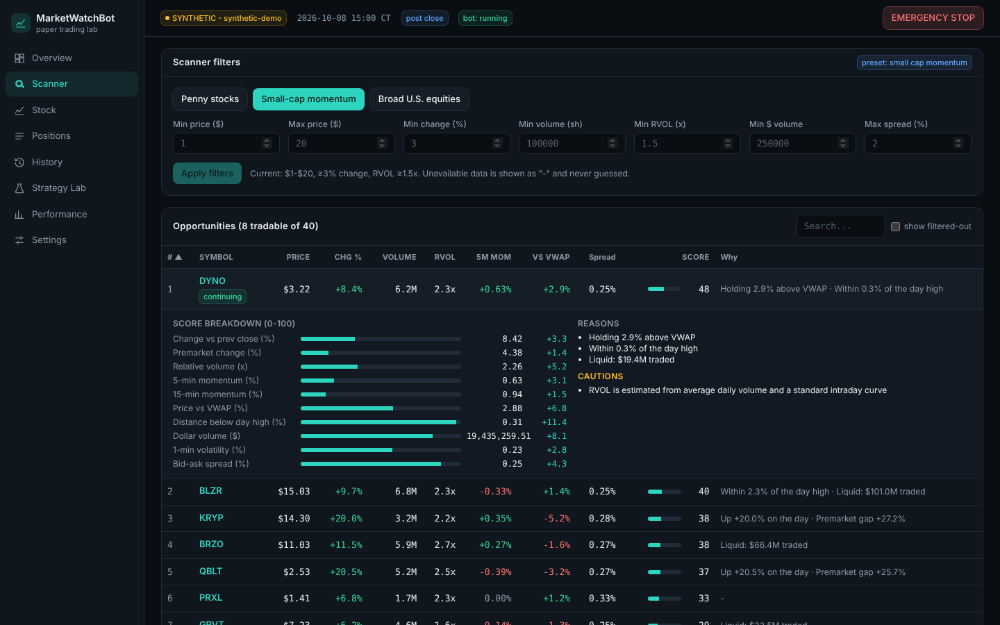
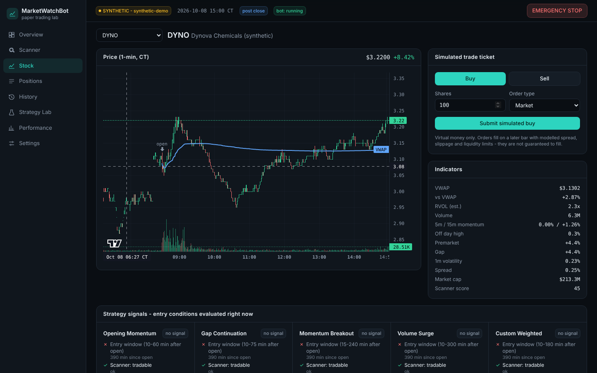
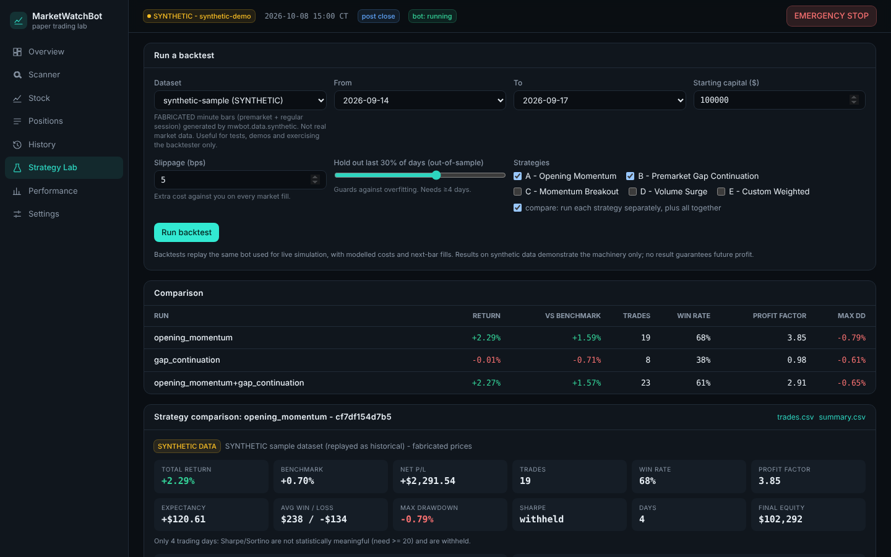
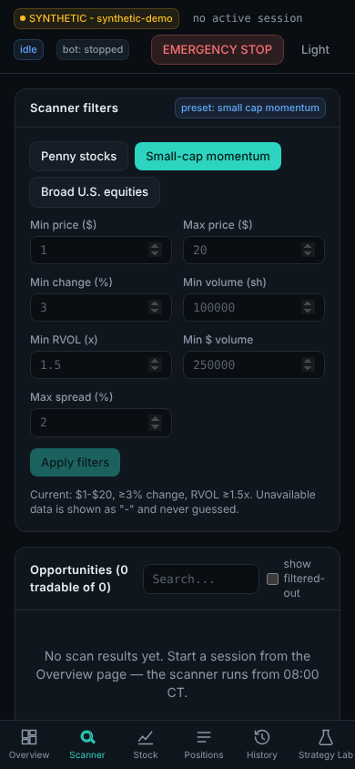

# MarketWatchBot

A **paper-trading** research bot for a friendly virtual-stock-market competition: it discovers fast-moving U.S. stocks, scores them transparently, simulates entries and exits with realistic costs, tracks every decision, backtests strategies, and shows it all in a live dashboard.

> **Safety, up front**
> * **Virtual money only.** There is no real-money execution path in this repository. `MWBOT_ALLOW_REAL_MONEY=true` is rejected at startup, and every execution adapter is hard-wired `is_real_money = False`.
> * **Nothing here is investment advice**, and no strategy is claimed to make money. Results on the bundled sample data are on **fabricated (synthetic) prices** and demonstrate the machinery only.
> * **MarketWatch is not connected yet.** The MarketWatch adapter is a documented, intentionally non-functional skeleton. See [docs/MARKETWATCH_INTEGRATION.md](docs/MARKETWATCH_INTEGRATION.md).



| Scanner (transparent scoring) | Stock detail (chart + strategy conditions) |
|---|---|
|  |  |

| Strategy Lab (backtests) | Phone layout |
|---|---|
|  |  |

## What it does

| Area | Implemented |
|---|---|
| Data | **Demo** (deterministic synthetic market, no keys) · **Historical** (CSV/CSV.GZ replay with strict validation) · **Connected** (Massive/Polygon-style REST, bring your own key, honest *delayed* vs *real-time* labels) |
| Scanner | % change, premarket, volume, RVOL, price, market cap, volatility, spread, 5/15-min momentum, VWAP distance, distance from high, liquidity, halts, abnormal data. Three presets (penny / small-cap momentum / broad). Every score is broken down per component with plain-English reasons; missing data is *marked unavailable*, never invented |
| Strategies | A Opening Momentum · B Premarket Gap Continuation · C Momentum Breakout · D Volume Surge · E Custom Weighted. Each lists entry/exit/risk rules, explains every decision condition-by-condition, and has tunable parameters |
| Virtual broker | Market/limit orders, partial fills, IOC/day orders, halts, spread + slippage + size impact, latency, commissions, idempotent order ids, strict order state machine, stop/target/trailing/time exits, sizing, daily-loss limit, position caps, entry cutoff, end-of-day liquidation that **reports honestly when it fails**, pause + emergency stop |
| Calendar | Real NYSE calendar (`exchange_calendars`): holidays, early closes, DST. Dashboard in America/Chicago |
| Backtester | Replays the *same* bot code as live simulation; next-bar fills; costs; in/out-of-sample split; sample-size warnings; reproducible result hash; CSV export; strategy comparison |
| Dashboard | React + TypeScript + Tailwind; Overview, Scanner, Stock Detail, Positions, History, Strategy Lab, Performance, Settings; dark by default; responsive |
| Execution adapters | `PaperBroker` (fully functional) · `MockBrowserAdapter` (Playwright vs a bundled fake trading site: login, preview/confirm, delays, rejections, session expiry, reconciliation) · `MarketWatchAdapter` (skeleton only) |
| Reliability | Structured logs, bounded exponential backoff, rate limiting, freshness checks (stale feed blocks entries), SQLite persistence + restart recovery, visible alerts |

## Quick start (demo mode — no API keys needed)

Requirements: Python 3.12+, Node.js 20+ (22 LTS recommended). Windows users: see **[docs/LOCAL_SETUP.md](docs/LOCAL_SETUP.md)** (PowerShell scripts included).

```bash
# 1. backend
python -m venv .venv && source .venv/bin/activate          # Windows: .\.venv\Scripts\Activate.ps1
pip install -e "backend[dev]"

# 2. dashboard
cd frontend && npm ci && npm run build && cd ..

# 3. run (serves API + dashboard)
cp .env.example .env                                         # optional: everything defaults to demo mode
mwbot serve                                                  # http://127.0.0.1:8000
```

Open the dashboard → **Overview → Start session** (pick "Instant" to run a whole synthetic trading day in seconds, or "Watch it" to stream it).

Headless alternatives:

```bash
mwbot demo-day --date 2026-10-08            # one full synthetic day, prints the daily report
mwbot backtest --dataset synthetic_sample --oos 0.3 --out reports/   # reproducible backtest + CSV export
mwbot make-sample-data --out backend/sample_data/synthetic_sample    # regenerate the labelled synthetic dataset
```

## Run the checks

```bash
ruff check backend && ruff format --check backend
(cd backend && mypy mwbot)
(cd backend && python -m pytest -m "not browser")           # ~4 min, no browser needed
(cd backend && python -m pytest -m browser)                 # needs: playwright install chromium, and a built frontend
(cd frontend && npm run typecheck && npm test && npm run build)
```

## Documentation

| Doc | Contents |
|---|---|
| [docs/ARCHITECTURE.md](docs/ARCHITECTURE.md) | Components, data flow, the timing/fill model, design decisions |
| [docs/STRATEGIES.md](docs/STRATEGIES.md) | Every strategy's rules, parameters, assumptions and limits |
| [docs/BACKTESTING.md](docs/BACKTESTING.md) | Running backtests, reading results, bias protections, known limits |
| [docs/MARKETWATCH_INTEGRATION.md](docs/MARKETWATCH_INTEGRATION.md) | What must be researched/authorised/built locally to connect MarketWatch |
| [docs/LOCAL_SETUP.md](docs/LOCAL_SETUP.md) | Step-by-step Windows setup (PowerShell, Python, Node, Chrome) |
| [docs/CLOUD_TO_LOCAL_HANDOFF.md](docs/CLOUD_TO_LOCAL_HANDOFF.md) | Implemented vs tested vs unfinished; what needs your PC, keys, or authorisation |
| [CLAUDE.md](CLAUDE.md) | Orientation for future Claude Code sessions |

## Layout

```
backend/mwbot/        Python package (domain, calendar, data/, scanner/, strategies/, trading/, bot/, backtest/, execution/, mocksite/, db/, api/, service.py, cli.py)
backend/tests/        259 tests (unit, integration, API, Playwright)
backend/sample_data/  labelled SYNTHETIC minute-bar dataset (10 sessions x 30 symbols)
frontend/             Vite + React + TypeScript + Tailwind dashboard (+ vitest suite)
docs/                 documentation, screenshots, demo outputs
scripts/              Windows PowerShell helpers
.github/workflows/    CI (lint, types, tests, browser tests, Windows smoke)
```

## Honest limitations (short list; full list in the handoff doc)

* Synthetic data is built from "regimes" I wrote; strategy results on it say nothing about real markets.
* Fills are modelled from 1-minute bars. Real queue position, hidden liquidity, halts and latency differ.
* The Massive provider follows the documented Polygon-compatible schema but was **not verified against the live service** from the build sandbox.
* RVOL is an estimate (average daily volume × a standard intraday curve) unless you supply per-minute historicals.
* Long-only, cash account (no shorting or margin).
